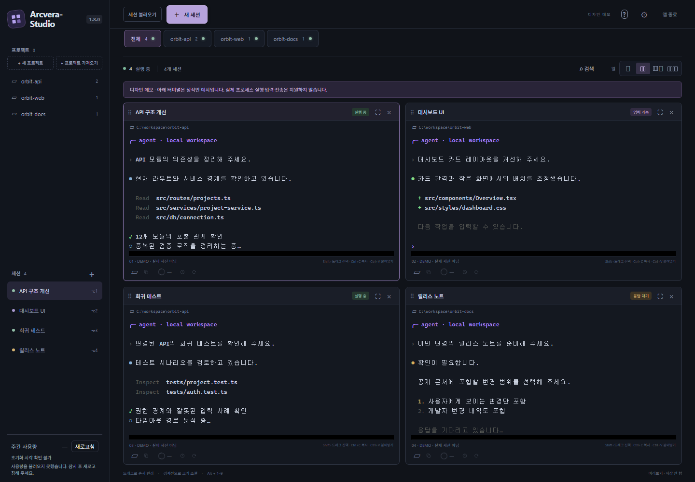

# Arcvera-Studio

A Windows workspace for running Arcvera Core sessions side by side. Group conversations
by project, arrange terminals in a resizable grid and return to saved work.

**English** | [한국어](README.ko.md)

[Download](https://github.com/jaeseongs95/Arcvera-Studio/releases/latest) ·
[Quick start](#quick-start) · [User guide](docs/user-guide.md) ·
[Development](docs/development.md)

*Design preview captured from an isolated browser fixture. The terminals contain
sample output; this image does not demonstrate native runtime or performance.*

Version **2.0.0** requires a stable Arcvera Core 1.x release. Official Codex and earlier Core
runtimes are no longer supported. Existing settings, authentication and
conversations are retained.
See [rename compatibility](docs/rebranding.md) and [release notes](docs/release-notes.md).

## Supported runtime

Desktop supports only stable [Arcvera Core](https://github.com/jaeseongs95/opendiy-codex) 1.x CLI and app servers. Install Core separately. Official Codex CLI support and the per-session server path have been removed.

Stable Core 1.x must provide shared-server `daemon` and `proxy` commands and the protected startup options `--existing-installation` and `--first-installation`. Each connection sends the full validated version of the connected server in the Core initialization contract. Explicit server replacement separately checks that the selected CLI and server package match. Feature controls depend on the connected server.

Existing settings, authentication and conversations are retained. If you previously used official Codex CLI, choose Core CLI and a supported server under **Executable settings**. Each must be stable Core 1.x; their versions may differ. Explicit server replacement requires a matching package. See [runtime selection and server transitions](docs/user-guide.md#runtime).

## Quick start

1. **Install Arcvera Core and sign in.** The CLI and connected server must each be stable Core 1.x.
   Desktop packages do not include or download Core.
2. **Install or extract Desktop.** Download the Windows x64 installer or portable
   ZIP from [Releases](https://github.com/jaeseongs95/Arcvera-Studio/releases/latest).
   Windows and WebView2 are required; builds are unsigned. For the portable edition,
   extract the **whole ZIP**. Check the download against the release's `SHA256SUMS.txt`,
   then launch the installed app or `arcvera-studio.exe`.
3. **Select your CLI.** Open **⚙ Settings → Executable settings** and choose the
   native `codex.exe` or installed `opendiy-codex-launcher.exe`. A server executable
   is selected automatically; specifying one separately is optional. Changing
   the CLI path preserves open terminals. Selecting an app-server file explicitly replaces
   the managed server when safe and reconnects eligible idle conversations with their drafts.
   Finish work in other Codex clients first. Sessions with pending work, attachments or
   terminal input that cannot be preserved block replacement; close those sessions yourself
   after finishing the work. See [server transitions](docs/user-guide.md#runtime).
4. **Open a project and a session.** Choose **Import project**, select an existing
   folder, then resume a conversation or create a new session. Use the CLI's own
   interface for model, sign-in and permission prompts. **Shift+Enter** inserts a
   line break in its prompt.

The interface defaults to Korean. Choose **한국어 / English** under
**Settings → Language** to change the app and tray language. CLI output and Windows
system labels keep their own language.

## Find your workflow

| I want to… | Guide |
| --- | --- |
| Group sessions, reorder projects or switch the grid | [Projects and terminals](docs/user-guide.md#projects) |
| Resume a saved conversation or restart one session | [History, restore and restart](docs/user-guide.md#restore) |
| Use conversation view and answer questions or approvals | [Conversation and question inbox](docs/user-guide.md#conversation) |
| Manage installed plugins, find a plugin or manage skills | [Plugins and skills](docs/user-guide.md#extensions) |
| Inspect hooks, change activation or review trust | [Hooks](docs/user-guide.md#hooks) |
| Search, filter and control direct subagents; confirm deletion of eligible completed agents | [Subagents](docs/user-guide.md#subagents) |
| Inspect usage, adjust one session's context size, compact or schedule work | [Context](docs/user-guide.md#context) · [Schedules](docs/user-guide.md#schedules) |
| Pair a phone with a running session | [Mobile remote control](docs/user-guide.md#mobile) |
| Check weekly usage or stored attachments | [Usage](docs/user-guide.md#usage) · [Storage](docs/user-guide.md#storage) |

## Closing, data and limitations

- **Closing the window hides it to the tray.** Use **Exit app** for a complete exit
  and confirmed cleanup of app-owned processes. Restoring later starts new processes
  against saved conversation IDs; it does not revive old process IDs or resend input.
- Desktop launches and owns its work processes directly through Windows Jobs.
  A separate Desktop helper executable is no longer required; Codex, shell and
  WebView2 processes still run separately.
- Codex owns authentication, configuration and conversation history. Desktop stores
  layout, projects, session metadata and preferences in its own SQLite database;
  it does not copy Codex authentication files or terminal transcripts into that database.
  Submitted pasted images are retained separately when history may reference them.
- Display and input buffers are bounded. This does not truncate model context or
  establish a limit for the CLI process's memory use.
- Physical phone pairing/control and long-duration leak testing remain unvalidated.
  Check each release's notes for the tests actually run and their limitations.

See the [user guide](docs/user-guide.md) for ownership, retry and recovery behavior.

## Development and verification

Built with Tauri 2, Rust/portable-pty, TypeScript, Vite and xterm.js.
The [development guide](docs/development.md) covers prerequisites, build commands,
packaging and diagnostic modes. Windows CI checks and packages the application;
build success alone does not prove GUI behavior or complete CLI compatibility.

Historical observations and their scope are linked in the
[verification notes](docs/development.md#verification). Please include the Desktop
version, selected CLI/server versions, reproduction steps and expected/actual
behavior in a [bug report](https://github.com/jaeseongs95/Arcvera-Studio/issues).
Do not attach credentials or private conversation logs.

## License and direction

An independent [MIT-licensed](LICENSE) implementation. Claudes' multi-terminal
workflow was a product reference; its code, assets and branding are not included.
See its [reference license](https://github.com/paulallington/Claudes/blob/v1.9.82/LICENSE).

The long-term goal is to replace the ChatGPT desktop app with Arcvera-Studio,
learning from ChatGPT and Claude desktop features and usability. That is future
direction, not a claim of current feature parity.
